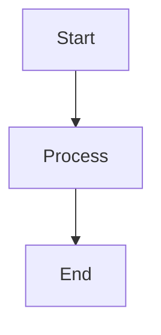

# Create Merge/Pull Request with Smart Description

Create a merge request (GitLab) or pull request (GitHub) with a concise, reviewer-friendly description (max 10 bullet points). Default new requests to draft; ready creation requires an explicit human request.

## Step 0: Detect Platform and Tool

Auto-detect the hosting platform and select the best available tool.

**Platform Detection:**
```bash
REMOTE_URL=$(git remote get-url origin 2>/dev/null)
```

| Remote URL pattern | Platform | Primary Tool | Fallback |
|-------------------|----------|-------------|----------|
| `github.com` | GitHub | `gh` CLI | - |
| `gitlab` (any instance) | GitLab | `glab` CLI | GitLab MCP tools |

**Tool Availability Check:**
- GitHub: `gh auth status`
- GitLab: `glab auth status`
- GitLab MCP: Check if `mcp__gitlab__*` tools are available

**Decision Matrix:**
| Platform | Condition | Use |
|----------|-----------|-----|
| GitHub | `gh` available | `gh` CLI |
| GitLab | `glab` available & authenticated | `glab` CLI (preferred) |
| GitLab | `glab` unavailable, MCP available | GitLab MCP tools |
| GitLab | Both available | `glab` CLI (preferred) |

## Step 1: Branch Management

Ask the user about branch preference:
- Do they want to checkout a specific branch?
- Stay on the current branch?
- If they already mentioned a branch, use that

Current branch: `{{ git.currentBranch }}`

### Jira Requirement: Work-Context Classification

Require or add a Jira key only when the repository's documented work context, remote organization, established branch/MR/CI conventions, or the user requires one. Personal repositories use their own conventions; do not ask for, look up, or invent a Jira key without that evidence. GitLab hosting alone does not imply a work repository or Jira requirement. If ownership remains unclear after checking the remote and contribution/CI rules, ask one concise question.

### Publication Identity: Personal/Public Versus Work

Apply the human/repository's identity policy to the target repository; personal/public work and company work may require different identities. Keep exact names, emails and usernames in private approved configuration. Do not infer the intended identity from GitLab/GitHub hosting alone or copy a sibling repository's policy.

Before any commit or push (including an implicit CLI push), verify the actual push destination and **both effective identities** in that exact worktree and process:

```bash
git remote get-url --push <remote>
git var GIT_AUTHOR_IDENT
git var GIT_COMMITTER_IDENT
git config --show-origin --show-scope --get-regexp '^(user|author|committer)\.(name|email)$'
```

`git var` is decisive: environment variables, command-scoped configuration and worktree overrides can defeat a correct repository-local `user.email`. Inspect the author and committer on the exact outgoing commit range too; changing configuration does not repair existing commits. Before committing, pushing or creating the request, verify the authenticated account for the actual host through its current-user endpoint (CLI or MCP), not merely the configured account name. Verify the Git push transport identity too; its SSH key/credential helper can differ from the provider CLI. Never print tokens, credentials or private keys.

If a required identity/account is unknown or mismatched, stop the affected commit/push/create and disclose it. When authorized, use per-operation identity/credentials or a repository/worktree-scoped correction, then repeat the effective checks. Preserve recovery evidence before correcting only your own unpushed commits in the authorized scope; do not rewrite published/shared history or another contributor's attribution. Do not change global identity, a private/work repository, or another account merely to fix a personal/public operation.

## Step 2: Check for Existing MR/PR

Before creating a new MR/PR, check if one already exists:

**GitHub:**
```bash
gh pr list --head "$(git branch --show-current)" --state all --json number,url,state,isDraft,title,headRefName,baseRefName
```

**GitLab (glab):**
```bash
glab mr list --source-branch "$(git branch --show-current)" --all --output json
```

**GitLab (MCP fallback):**
- Use `mcp__gitlab__get_merge_request` with `source_branch: current branch`

If an MR/PR exists and is:
- **Open:** Reuse its URL; update the description only when requested/authorized. Preserve its title and draft/ready state unless separately asked to change them; do not create another request.
- **Merged:** Inform the user that changes are already merged
- **Closed:** Ask if they want to create a new one or reopen

Confirm source and target repository/branch identity; paginate if needed. Treat lookup failures as unknown, not absent. If none exists, proceed to create a new one.

## Step 3: Analyze Changes

Analyze git diff and commit messages to understand what changed:
```bash
# Detect default branch
DEFAULT_BRANCH=$(git symbolic-ref refs/remotes/origin/HEAD 2>/dev/null | sed 's@^refs/remotes/origin/@@' || echo "main")
git diff origin/${DEFAULT_BRANCH}...HEAD
git log origin/${DEFAULT_BRANCH}..HEAD --oneline
```

## Step 4: Discover Title Policy and Generate Title

Inspect checked-in CI, contribution, release and changelog rules before choosing a title. An evidenced title validator takes precedence over branch-name heuristics. Preserve the logical title and required prefix order; draft state does not change the intended release impact or Jira classification.

If the repository requires a leading release prefix, choose its supported prefix from the actual change: for example `PATCH:` for compatible fixes/maintenance, `MINOR:`/`FEATURE:` for compatible features, or `MAJOR:`/`BREAKING:` for incompatible changes. Put any required Jira key after that prefix, for example `FEATURE: ABC-123 - Add export filters`. These are examples, not a universal title policy. Validate the logical title against the actual repository rule.

### Title Format

If there is no explicit title policy, auto-detect title style from the branch name:

- **Ticket-prefixed branches** (e.g., `CWS-2838-add-feature`): `CWS-2838 - Add feature description`
- **Conventional branches** (e.g., `feature/add-auth`, `fix/login-bug`): `feat: Add auth` / `fix: Resolve login bug`
- **Other branches**: Use a concise descriptive title

### Description Format (MAX 10 BULLET POINTS)

```markdown
## Summary
Brief 1-2 sentence description of what this MR/PR does.

## Changes Made
- [List 3-5 key changes with specific details]
- [Group by category if needed: Frontend, Backend, Database, Tests]
- [Be precise - avoid vague terms like "improved" or "fixed"]

## Technical Details (Optional - use ONE format if helpful)

**Option A - Before/After:**
- **Before:** Old behavior
- **After:** New behavior

**Option B - Table (for config/data changes):**
| Field | Before | After | Reason |
|-------|--------|-------|--------|
| ... | ... | ... | ... |

**Option C - Mermaid (for complex flows):**


## Testing
- [ ] Tests pass locally
- [ ] Manually verified key flows

## Related Links
- Ticket: [TICKET-ID](link) (if applicable)
- Related MRs/PRs: (if any)
- Documentation: (if updated)
```

**IMPORTANT:** Keep total bullet points under 10. Combine related items if needed.

## Draft State and Title Validation

Create **new** MRs/PRs as drafts unless the human explicitly requests **ready creation**. A request to create an MR, passing checks, or a general goal to make work ready does not override this default. For an explicit ready-creation request, omit `--draft` and the GitLab draft marker. Preserve existing MR/PR draft/ready state unless the human separately requests changing it.

Keep `MR_TITLE` as the logical title generated above. GitHub stores draft state separately; GitLab's draft mechanism adds a leading `Draft:` marker. Do not move a required release prefix behind the Jira key or duplicate the draft marker. Check whether title validators and release/changelog tooling handle that marker. A rule anchored to `^(PATCH|MINOR|FEATURE|MAJOR|BREAKING):` rejects the displayed `Draft: FEATURE: ...` title unless it explicitly normalizes draft markers.

If a draft is accepted but its title fails CI, keep it draft and report the precise policy incompatibility. Do not weaken/skip validation, silently make it ready, or claim the logical title alone proves CI passes. If server-side validation prevents draft creation, stop with the prepared title/body and explain the blocker. Correcting MR metadata may require an explicit retry of the title-validation job; metadata edits do not guarantee a new pipeline.

## Step 5: Create the MR/PR

Write the exact description to a temporary file outside the repository using a file tool; set `MR_BODY_FILE` to its absolute path. Pass Markdown as a file or structured tool argument, keeping newlines, backticks and `$()` literal. Use the generated `MR_TITLE`, source and target branches rather than replacing them with example text.

The examples create drafts. Omit only `--draft` when the human explicitly requested ready creation.

**GitHub:**
```bash
gh pr create \
  --draft \
  --head "$(git branch --show-current)" \
  --base "$DEFAULT_BRANCH" \
  --title "$MR_TITLE" \
  --body-file "$MR_BODY_FILE"
```

**GitLab (glab - preferred):**
```bash
glab mr create \
  --draft \
  --source-branch "$(git branch --show-current)" \
  --target-branch "$DEFAULT_BRANCH" \
  --title "$MR_TITLE" \
  --remove-source-branch \
  --description "$(cat "$MR_BODY_FILE")" \
  --yes
```

Use `--description-file "$MR_BODY_FILE"` instead of `--description` when the installed `glab mr create --help` supports it. The quoted file read above supports older glab versions without interpreting the description as shell code.

**GitLab (MCP fallback):**
Use the available `create_merge_request` tool with structured arguments matching its actual schema:
- Project identity from the git remote
- Source branch: current branch
- Target branch: detected default branch
- Description: exact prepared Markdown
- Title: `Draft: <MR_TITLE>` for draft creation; the logical title for explicitly requested ready creation. If the tool exposes a documented draft parameter, use it as supported and still verify the server state. Do not invent a `draft` argument.
- Set remove-source-branch on merge when supported; if a separate update is necessary, preserve draft state.

If creation fails or times out, repeat the existing-request lookup before retrying or falling back: the first call may already have created the MR/PR. Do not create a duplicate or treat an authentication/network error as proof that none exists. Retain the chosen draft/ready state on every fallback.

## Step 6: Verify the Server State

Read the resulting MR/PR from the provider after creation or reuse; a title marker or successful CLI exit is insufficient:

```bash
# GitHub: inspect isDraft plus title and branch identity.
gh pr view <url-or-number> --json url,isDraft,title,headRefName,baseRefName

# GitLab: inspect draft plus title and source/target branch identity.
glab api "projects/:fullpath/merge_requests/<iid>"
```

For MCP-only use, fetch the MR/PR with its read tool and inspect the same provider fields. Expect `isDraft: true`/`draft: true` for new default creation and `false` for explicitly requested ready creation. If a newly created request has the wrong state, correct that same request to the chosen state and re-read it; making it ready is permitted only for an explicit ready-creation request. If verification or correction is unavailable, report state as unverified/blocked. Never change a reused request merely to enforce the new-creation default. Attach each created PR/MR when the current runtime provides an applicable artifact tool.

## Guidelines

1. **Be Precise:** Explain what and how, not just "fixed" or "improved"
2. **Use Visual Aids Sparingly:** Only if it significantly helps understanding
3. **Stay Concise:** Max 10 bullet points total across all sections
4. **Think Like a Reviewer:** What's the minimum info needed to review?

## Final Step

After creating the MR/PR, provide:
- MR/PR URL
- Verified draft/ready state (or the exact verification blocker)
- Brief summary and any title-policy incompatibility
- Reminder to assign reviewers when ready
